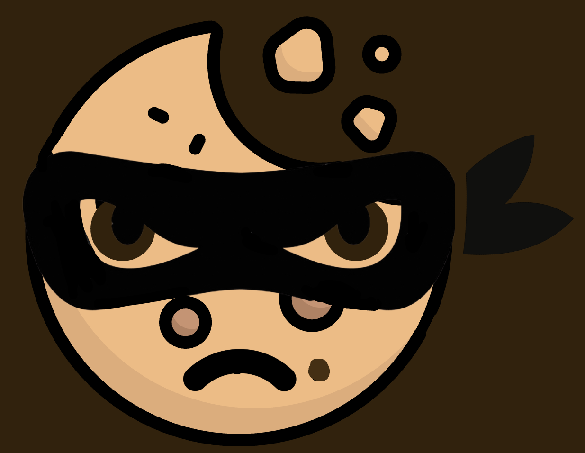

<p align="center">
  
</p>

<h1 align="center">Cookie Crumbs</h1>

<p align="center"><b>Follow your cookie trail. See where your data goes.</b></p>

<p align="center">
  
  
  
  
</p>

---

## About

Cookie Crumbs is a browser extension turned website that follows your cookie trail to see where your data goes and how it's being used. From finding third-party vendors to uncovering how many cookies a site uses, Cookie Crumbs is your one-stop cookie shop. Install the Chrome extension and open up the cookie jar to learn more about the cookies that follow you around.

## Features

| Feature                  | What it does                                                                                                                                                                                                                         |
| ------------------------ | ------------------------------------------------------------------------------------------------------------------------------------------------------------------------------------------------------------------------------------ |
| **Cookie jar**           | An overview for each site: a crumb score (0 to 100, higher means more tracking), plus counts of cookies, trackers, third-party requests and permissions.                                                                             |
| **Crumb trail**          | An interactive tracker graph. The site sits in the middle as a cookie, and every crumb around it is a domain it phoned home to. Trackers loaded by other trackers branch further out.                                                |
| **Privacy X-Ray**        | Click any crumb to see the domain, its category, how many requests it made, the cookies it set, who owns it, and whether it's on a known tracker list.                                                                               |
| **AI Privacy Detective** | Domains that aren't on the known tracker list get an AI estimate (advertising, analytics, social or fingerprinting) with a confidence score. Estimates are always labeled as guesses, and nothing is called malicious without proof. |
| **Taste test**           | Compare two scanned sites side by side, on the same scale, to see which one is crumbier.                                                                                                                                             |
| **Cookie class**         | Plain-English explanations of first-party vs. third-party cookies, trackers, fingerprinting and the crumb score.                                                                                                                     |
| **Privacy history**      | Opt in to saving scan summaries so you can compare sites over time.                                                                                                                                                                  |

## Tech Stack

**Languages:** Python, TypeScript

**Frontend**

- [React](https://react.dev/) + [TypeScript](https://www.typescriptlang.org/), built with [Vite](https://vite.dev/)
- [Tailwind CSS v4](https://tailwindcss.com/) for styling
- [Cytoscape.js](https://js.cytoscape.org/) for the crumb trail tracker graph

**Backend**

- [FastAPI](https://fastapi.tiangolo.com/) (Python)
- [Neon Postgres](https://neon.tech/) for preferences, tracker classifications and scan history
- [Hugging Face](https://huggingface.co/) open-source models for classifying unknown tracker domains
- [Gemini API](https://ai.google.dev/) for plain-English privacy explanations
- [Vultr](https://www.vultr.com/) for hosting

**Extension**

- Chrome Extension (Manifest V3) using the `chrome.cookies`, `chrome.webRequest` and `chrome.storage` APIs

## How It Works

```
 Chrome extension            Backend (FastAPI)                 Dashboard (React)
 ┌──────────────────┐        ┌────────────────────────────┐    ┌────────────────────┐
 │ reads cookie     │        │ 1. match domains against   │    │ crumb score        │
 │ metadata +       │ ─────▶ │    the known tracker list  │──▶ │ crumb trail graph  │
 │ third-party      │summary │ 2. AI estimate for unknown │    │ Privacy X-Ray      │
 │ requests         │        │    domains (+ confidence)  │    │ taste test         │
 └──────────────────┘        │ 3. score + save to Neon    │    └────────────────────┘
                             └────────────────────────────┘
```

1. The **extension** collects cookie metadata and observes third-party requests on the page you're visiting.
2. It sends a **minimized summary** (domains, counts, categories) to the backend. Raw browsing activity never leaves your browser.
3. The **backend** checks each domain against a trusted tracker list first. Only domains that aren't on it go to the AI model, which returns a category estimate and a confidence score.
4. The **dashboard** shows the results: the crumb score, the tracker graph, and an X-Ray for every crumb.

## Privacy

Cookie Crumbs is a privacy tool, so it holds itself to the same standard:

- Raw browsing activity stays on your device.
- Only summaries you explicitly approve are saved, and history is opt-in.
- The AI is only used for domains that aren't on the known tracker list, and its output is always shown as an estimate with a confidence score.

## Project Structure

```
cookie-crumbs/
├── backend/
│   ├── app/
│   │   ├── data/
│   │   │   └── tracker_domains.json   # known tracker list (ground truth)
│   │   ├── db/
│   │   │   └── connection.py          # Neon Postgres connection
│   │   ├── routes/                    # API endpoints
│   │   │   ├── ai.py
│   │   │   ├── health.py
│   │   │   ├── history.py
│   │   │   ├── preferences.py
│   │   │   ├── scan.py
│   │   │   └── tracker.py
│   │   ├── schemas/                   # request / response models
│   │   │   ├── ai.py
│   │   │   ├── history.py
│   │   │   ├── preferences.py
│   │   │   ├── scan.py
│   │   │   └── tracker.py
│   │   ├── services/                  # business logic
│   │   └── main.py                    # FastAPI app entry point
│   ├── .env.example
│   └── requirements.txt
│
├── frontend/
│   ├── public/
│   │   └── logo.png
│   ├── src/
│   │   ├── components/                # CrumbTrail, XRayPanel, Sidebar, CookieScore, ...
│   │   ├── data/
│   │   │   └── mockScans.ts           # mock data + the shared types the API returns
│   │   ├── pages/
│   │   │   ├── LoginPage.tsx
│   │   │   └── Dashboard.tsx
│   │   ├── views/                     # Cookie jar, Crumb trail, Taste test, Cookie class
│   │   ├── App.tsx
│   │   ├── index.css                  # Tailwind + Cookie Crumbs theme colors
│   │   └── main.tsx
│   ├── package.json
│   └── vite.config.ts
│
└── README.md
```

## Getting Started

### Prerequisites

- [Node.js](https://nodejs.org/) 20+
- [Python](https://www.python.org/) 3.10+
- A [Neon](https://neon.tech/) Postgres database
- API keys for Hugging Face and Gemini

### 1. Clone the repo

```bash
git clone https://github.com/ntrejo12/cookie-crumbs.git
cd cookie-crumbs
```

### 2. Run the frontend

```bash
cd frontend
npm install
npm run dev
```

Open the `localhost` link it prints. The dashboard runs on mock data (`src/data/mockScans.ts`) until it's connected to the backend.

### 3. Run the backend

```bash
cd backend
python3 -m venv venv
source venv/bin/activate        # Windows: venv\Scripts\activate
pip install -r requirements.txt
cp .env.example .env            # then fill in your keys
uvicorn app.main:app --reload
```

The API runs at `http://localhost:8000`, with interactive docs at `http://localhost:8000/docs`.

### Environment variables

Copy `backend/.env.example` to `backend/.env` and fill in the values. You'll need your Neon connection string and your Hugging Face and Gemini API keys. **Never commit `.env`.**
